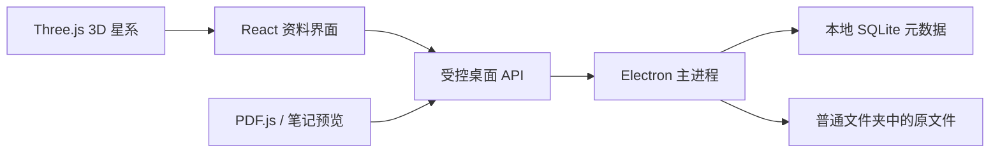

# 知识星系

一个供个人电脑本地使用的教学资料管理应用。文件保存在普通文件夹中，分类、标签和关联保存在本地 SQLite 数据库中。独立的 3D 星系可以旋转、平移、缩放，沿着关联浏览资料。

## 直接体验

Windows 64 位用户双击 `启动知识星系.cmd`，或运行 `release/KnowledgeGalaxy-0.2.0-x64.exe`。首次运行会打开带有 20 份真实文件的示例资料库，其中包含测试用 PDF 和 Markdown 练习、笔记。示例内容用于体验功能。

1. 点击左上角资料库名称，选择自己的资料文件夹，也可以新建空文件夹。
2. 点击“导入文件”，将资料复制到当前资料库；同内容文件会自动跳过。
3. 在“分类与标签”创建年级、章节、教学进度等维度以及自己的标签。
4. 选择资料，在右侧点击属性或标签旁的“编辑”，填写分类与标签，或添加关联。重命名、移动和回收操作位于右侧“…”菜单。
5. 打开“星系”，拖动空白处旋转，滚轮缩放，右键拖动平移；点击节点或搜索名称聚焦。资料筛选默认收起，点击工具栏的筛选按钮展开。
6. 拖动星点可固定位置，点击“保存布局”保留位置；“重排”释放固定位置。

右上角“…”提供完整备份和恢复。备份包括文件、数据库、分类、关系和布局；恢复时创建一个新资料库文件夹。

## 当前已经实现

0.2 版采用白色界面、浅灰侧栏与少量紫色强调。移除英文眉题、口号和重复筛选，列表与图谱使用紧凑工具栏；属性、标签和分类选项按需展开。

- 本地文件夹资料库，支持 PDF、Word（doc/docx）、Markdown、TXT、PNG/JPG/GIF/WebP。
- 文件列表、文件夹/类型/分类/标签筛选，以及资料名称、标签和关联节点搜索。
- 自定义单选、多选、层级、文本、数字、日期分类；层级父项筛选包含后代选项。
- 自定义标签和颜色、批量添加标签。
- 章节、知识点、专题节点；自定义有方向的关系类型，查看正向和反向关联。
- PDF 翻页预览、图片预览、Markdown/TXT 原文编辑；Word 使用本机默认应用打开。
- 新建笔记、文件移动与改名、可恢复的回收站。通过应用移动或改名时，文件 ID 和关联保持不变。
- 真正的 WebGL 3D 星系：搜索聚焦、一层/两层关联、按分类或标签聚集、布局保存。
- SQLite 持久化、文件内容去重、完整 ZIP 备份与校验恢复。

星系中，每份文件只有一个节点。分类和标签连线由资料属性生成；手动关联另外保存。聚集只调整位置和颜色，不生成新的知识关系。

## 目前的范围

这是可运行的第一版基础项目。当前搜索不包含 PDF/Word 全文；OCR、AI 自动标注、云同步、全文检索、自定义维度/标签的删除和改名尚未实现。

在文件管理器中直接移动文件会显示“文件丢失”，重新定位功能待补。新增的外部文件可通过重新选择当前资料库扫描。使用应用内的移动、改名功能可以保留关联。

单个导入文件上限 200 MB，备份总内容上限 512 MB。资料库未加密。运行不依赖账号或网络；首次安装开发依赖和构建桌面运行环境需要下载。

## 开发运行

需要 Node.js 22.12 或更高版本，以及 pnpm 11.25。依赖版本已锁定。

```powershell
pnpm install --frozen-lockfile
pnpm dev
```

`pnpm dev` 同时启动本地界面开发服务和桌面窗口。开发用户设置位于项目 `.runtime/appdata`，示例资料库位于 `.runtime/示例资料库`。自己的资料库保存到用户选定的位置。

```powershell
pnpm typecheck
pnpm test
pnpm build
pnpm start
pnpm package:win
```

`pnpm start` 打开已构建的桌面应用。`pnpm package:win` 生成 Windows 便携版。当前发行包未签名。

`pnpm dev:web` 仅供浏览器预览。浏览器模式明确标记为示例：数据保存在当前浏览器，不能选择本机资料文件夹、调用系统应用或执行桌面备份。桌面版通过安全桥接访问真实文件与数据库。

## 代码结构

```text
src/App.tsx                        资料、分类、标签和关联界面
src/domain.ts                      前后端共享数据与操作契约
src/api.ts                         桌面 API / 浏览器示例选择
src/demo.ts                        浏览器示例适配器
src/components/GalaxyView.tsx      Three.js / force-graph 3D 星系
src/components/DocumentPreview.tsx PDF.js、图片与笔记预览
electron/preload.cjs                受控桌面桥接
electron/main.cjs                   窗口、文件对话框与安全 IPC
electron/repository.cjs             SQLite、文件、导入、备份和恢复
tests/backend.test.cjs              数据与文件完整性测试
```



每个资料库中的 `.galaxy/catalog.sqlite` 保存分类、标签、知识节点、关系和布局；回收文件放在 `.galaxy/trash`。文档采用稳定 UUID 和库内相对路径，便于整体移动和备份。

Electron 使用进程隔离、渲染器沙箱、受控 IPC 和路径校验。写入异常会回滚本次数据库与文件操作；这不等于具备完整的断电恢复日志。

## 验证

后端测试覆盖数据库重载、分类关系、移动改名后 ID 稳定、回收恢复、内容去重、越界路径/无效引用拒绝、文件丢失、写入失败回滚、备份恢复与篡改拒绝。

桌面集成验证包含真实 SQLite 桥接、PDF 预览、自定义层级分类、标签、笔记编辑、关联创建、刷新后的保存结果，以及 WebGL 3D 星系与布局持久化。

后续可在这个基础上继续增加全文检索、OCR、自定义类别编辑和更完整的文件变更跟踪。
