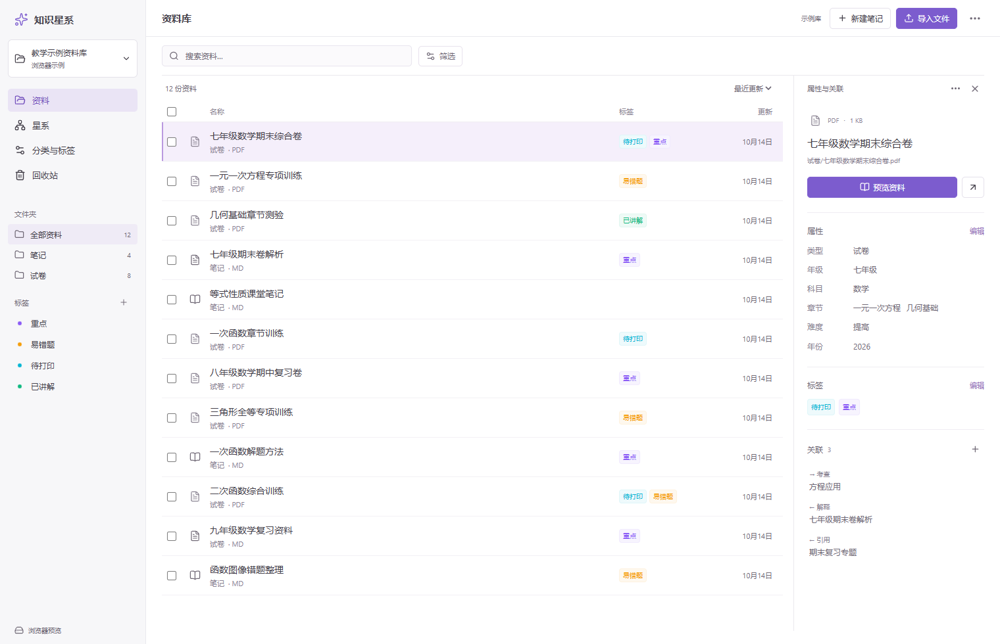
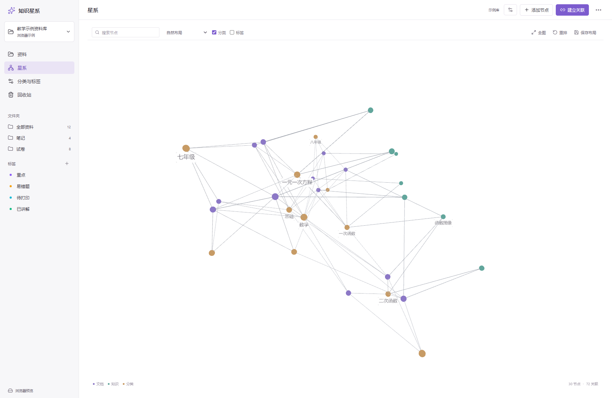
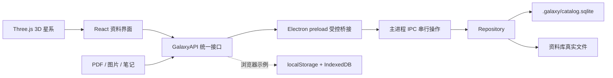

# NoteOrbit

**把文件、分类、标签和知识关联放进同一个本地资料库。**

NoteOrbit（知识星系）是面向个人电脑的教学资料管理应用。文件保存在普通文件夹中，分类、标签、关系和星系布局保存在本地 SQLite 数据库中。可以整理试卷与笔记，也可以在独立的 3D 星系中旋转、缩放、聚焦节点，沿关联寻找资料。

当前版本：**0.2.2**。已提供 Windows x64 便携版。日常使用不需要账号、服务器或网络。

[下载 Windows 便携版](https://github.com/zzyyyds0/noteorbit/releases/latest) · [查看 0.2.2 发布说明](https://github.com/zzyyyds0/noteorbit/releases/tag/v0.2.2)





## 目录

- [快速开始](#快速开始)
- [功能与格式支持](#功能与格式支持)
- [按教学场景整理资料](#按教学场景整理资料)
- [3D 星系](#3d-星系)
- [搜索、筛选和保存](#搜索筛选和保存)
- [文件与数据位置](#文件与数据位置)
- [备份、恢复和迁移](#备份恢复和迁移)
- [架构与数据模型](#架构与数据模型)
- [代码结构](#代码结构)
- [开发、检查和打包](#开发检查和打包)
- [常见问题](#常见问题)
- [当前限制与后续方向](#当前限制与后续方向)
- [本次代码审查与优化](#本次代码审查与优化)

## 快速开始

### Windows 便携版

从 [GitHub Releases](https://github.com/zzyyyds0/noteorbit/releases/latest) 下载 `NoteOrbit-0.2.2-x64.exe`，双击即可运行，无需下载源码。

在包含发行包的项目目录中双击 `启动NoteOrbit.cmd`，或直接运行：

```text
release/NoteOrbit-0.2.2-x64.exe
```

便携版无需安装 Node.js。发行包由本地构建生成，`release/` 未纳入 Git；仅下载源码时，需要先按[开发、检查和打包](#开发检查和打包)生成程序。

首次启动会创建示例资料库，包含 **20 份真实文件：1 份 PDF 和 19 份 Markdown**，以及分类、标签和知识关联。示例文件用于体验功能，可以编辑，也可以切换到自己的资料库。

1. 点击左上角资料库名称，选择自己的资料文件夹，也可以选择新建的空文件夹。
2. 点击“导入文件”，将文件复制到资料库的 `导入/` 文件夹。桌面版按内容去重，同名且内容不同的文件会添加序号。
3. 在“分类与标签”中创建维度、选项和标签。
4. 点击资料，在右侧“属性”或“标签”旁点击“编辑”，设置分类与标签。
5. 点击“关联”的加号，选择起点、关系类型和终点。
6. 打开“星系”，浏览资料之间的联系。

右上角“…”提供打开资料库、备份和恢复。文件详情中的“…”提供文件重命名、移动和移入回收站。

### 使用已有资料文件夹

选择文件夹后，应用会递归扫描支持的文件，不要求先通过导入添加；已有文件保留在原来的位置。

扫描跳过以 `.` 开头的文件和目录、符号链接、不支持格式和超出限制的文件，递归深度最多 30 层。**打开资料库会创建或更新 `.galaxy/` 元数据目录，请选择可写文件夹。**

## 功能与格式支持

| 能力                                     | 桌面版                     | 浏览器示例                |
| ---------------------------------------- | -------------------------- | ------------------------- |
| 选择本地资料文件夹                       | 读写真实文件               | 不支持                    |
| 新建笔记、分类、标签、知识节点、关系类型 | 支持                       | 支持                      |
| 导入文件                                 | 复制、内容去重、同名不覆盖 | 存入浏览器缓存，用于体验  |
| 属性、标签与批量加标签                   | 支持                       | 支持                      |
| 资料与关联搜索、组合筛选                 | 支持                       | 支持                      |
| PDF、图片预览和文本编辑                  | 支持                       | 支持，内置 PDF 为演示内容 |
| 打开原文件                               | 调用本机默认应用           | 不支持                    |
| 移动、改名、回收与恢复                   | 操作真实文件，保留 ID      | 只改变示例记录            |
| 3D 星系、聚焦、分组、布局保存            | 支持                       | 支持                      |
| 完整 ZIP 备份与恢复                      | 支持                       | 不支持                    |
| 数据保存                                 | 普通文件夹 + SQLite        | localStorage + IndexedDB  |

浏览器示例与桌面资料库相互独立，编辑结果不会自动迁移。浏览器缓存受浏览器和站点存储限制，不适合保存唯一一份正式资料。

| 格式                                     | 应用内使用方式                             |
| ---------------------------------------- | ------------------------------------------ |
| `.pdf`                                   | PDF.js 预览、翻页，随面板宽度调整页面      |
| `.md`、`.markdown`、`.txt`               | UTF-8 原文编辑，点击“保存笔记”写回文件     |
| `.png`、`.jpg`、`.jpeg`、`.gif`、`.webp` | 图片预览                                   |
| `.doc`、`.docx`                          | 管理属性与关系，使用本机默认应用查看或编辑 |

Word 内嵌预览、Markdown 排版预览与文件正文检索尚未实现。文件格式与“试卷、解析、笔记、教材、图片、其他”这些资料类型是两个独立属性。

## 按教学场景整理资料

### 文件夹、分类、标签和关系各管什么

| 对象     | 适合表达                 | 示例                           |
| -------- | ------------------------ | ------------------------------ |
| 文件夹   | 文件的实际位置           | `试卷/七年级/期末/`            |
| 分类维度 | 可重复使用的结构化属性   | 年级、科目、章节、难度、年份   |
| 标签     | 跨类别的状态或临时标记   | 待打印、易错题、本周讲解       |
| 知识节点 | 没有独立文件的概念或专题 | 等式性质、七年级期末复习       |
| 手动关系 | 两个对象的具体逻辑       | 试卷“考查”方程，笔记“解释”试卷 |

同一份文件只保存一份，只有一个文档节点，可以属于多个维度和多个标签。跨年级、跨章节的联系通过属性和关系表达，无需重复复制文件。

### 自定义多维分类

在“分类与标签”点击“新建分类”，填写名称并选择形式。选项类维度可继续“添加选项”，层级维度可以指定上级选项。

| 形式          | 每份资料的值             | 示例                             |
| ------------- | ------------------------ | -------------------------------- |
| 单选 `single` | 一个选项或未设置         | 年级 = 七年级                    |
| 多选 `multi`  | 多个选项                 | 考点 = 方程、几何                |
| 层级 `tree`   | 多个选项，选项有父子结构 | 七年级上册 → 一元一次方程 → 移项 |
| 文本 `text`   | 短文本                   | 来源 = 某校月考                  |
| 数字 `number` | 有效数字                 | 年份 = 2026，满分 = 120          |
| 日期 `date`   | 有效的 `YYYY-MM-DD`      | 使用日期 = 2026-10-14            |

层级分类允许同时选择多个章节；选择子项不会自动勾选父项。

**按父项筛选时，包含选择了任意后代选项的资料。**

选项类分类可以直接筛选；文本、数字和日期目前通过搜索匹配，尚无数值或日期区间筛选器。

### 一个完整例子

假设导入 `七年级数学期末卷.pdf` 与 `期末卷解析.md`：

1. 创建“年级”单选、“科目”单选、“章节”层级、“年份”数字四个维度。
2. 给试卷设置：七年级、数学、一元一次方程与几何图形初步、2026。
3. 创建“待打印”和“易错题”标签，分配给资料。
4. 创建“一元一次方程”章节、“等式性质”知识点和“期末复习”专题。
5. 建立 `试卷 —考查→ 等式性质`、`解析 —解释→ 试卷`、`专题 —包含→ 章节`。
6. 在星系中聚焦试卷，选择一层或两层关联，查看解析、考点与相关资料。

标签支持自定义名称与颜色。列表中勾选多份资料后可一次添加标签，保留已有标签，且不会重复添加。被筛选隐藏的资料会从当前勾选中移除。

## 3D 星系

使用 Three.js 和力导向布局，是真正可操作的 WebGL 2 三维场景。

| 操作                   | 效果                                               |
| ---------------------- | -------------------------------------------------- |
| 空白处按住左键拖动     | 旋转视角                                           |
| 滚轮                   | 放大、缩小                                         |
| 按住右键拖动           | 平移视角                                           |
| 点击节点               | 聚焦并打开属性与关联                               |
| 搜索节点名称并点击结果 | 定位资料、知识节点、分类或标签                     |
| 一层关联 / 两层关联    | 查看所选节点附近的结构                             |
| 全图                   | 让当前图谱适合视口                                 |
| 按分类或标签分组       | 调整星团位置与颜色                                 |
| 拖动节点               | 固定节点位置                                       |
| 保存布局               | 保存当前坐标，重新打开后沿用                       |
| 重排                   | 释放当前固定位置，重新计算；需再次保存才写入新布局 |

四类节点为文档、知识节点、分类选项和标签。默认减少文字显示，突出核心节点与当前关注节点。

两类连线分别是：

- **手动关系**：通过“建立关联”创建并保存，有起点、终点和关系类型；详情显示正向和反向关系。
- **分类与标签边**：根据文档属性生成，可分别显示或隐藏，修改属性后随之更新。

分组只影响位置与颜色，不创建知识关系。一层、两层探索按相邻节点展开，方向可在详情中查看。层级分类的父子结构目前用于选项路径和筛选，不自动转成知识关系。

资料筛选会同步约束图中的文档，并保留它们的关联上下文。未分配的分类选项和标签通常不单独显示，存在手动关系时仍可显示。

## 搜索、筛选和保存

### 搜索范围

资料搜索匹配标题、库内路径、已分配标签、分类选项与层级路径、文本/数字/日期分类值，以及与资料直接相连的对象名称，包括正向与反向关联。

搜索忽略英文大小写和首尾空格，采用文本包含匹配。

**不搜索 PDF、Word 或 Markdown 正文，也不递归搜索多层关联。**

星系工具栏搜索用于定位图中节点，与资料筛选是两个入口。

文件夹、资料类型、一个标签与多个选项类分类可以组合，条件同时满足才显示。点击“清除”恢复全部资料；列表支持最近更新和名称排序。

### 保存与文件操作

- 属性与标签立即保存；文本笔记需要点击“保存笔记”，当前没有自动保存或版本历史。
- 保存失败会保留编辑区正文，可继续编辑或重试；保存中暂时禁止关闭与继续输入。
- 关闭预览前请先保存需要保留的修改，关闭后未保存正文不会保留。
- “属性 → 名称”只修改显示标题；“文件操作 → 重命名文件”改变实际文件名，同时更新标题。
- 重命名必须保留扩展名。移动填写库内相对路径，例如 `试卷/七年级/期末`，留空表示根目录。
- 回收站移动真实文件，恢复保留 ID、分类、标签和关系。原位置被占用时，使用带序号的新名称。

## 文件与数据位置

### 资料库目录

```text
我的资料库/
├─ 试卷/                       已有文件可保留原目录结构
├─ 导入/                       通过应用导入的文件
├─ 笔记/                       应用新建的 Markdown
└─ .galaxy/
   ├─ catalog.sqlite           文档记录、分类、标签、关系、布局
   └─ trash/                   回收站中的真实文件
```

文档使用稳定 UUID 和库内相对路径。通过应用移动或改名时 ID 不变，关系无需重建。整体迁移必须保留隐藏的 `.galaxy/` 目录。

SQL.js 在内存中操作 SQLite，写入后导出快照，经临时文件替换保存。操作抛出异常时恢复数据库并补偿本次文件变动。**当前没有完整断电恢复日志，不支持多个程序同时写同一库。**

### 应用设置

| 场景               | 默认位置                           |
| ------------------ | ---------------------------------- |
| Windows 便携版设置 | `%APPDATA%\NoteOrbit\library.json` |
| 便携版初始示例库   | `%APPDATA%\NoteOrbit\示例资料库\`  |
| 源码开发设置       | 项目 `.runtime/appdata/`           |
| 源码开发示例库     | 项目 `.runtime/示例资料库/`        |
| 自己选择的资料库   | 用户指定的文件夹                   |

便携版无需安装，但设置与默认示例库仍使用用户目录。自己的资料库不会搬到程序目录。

升级时沿用已有 `library.json`，设置目录按 `NoteOrbit`、`知识星系`、`knowledge-galaxy` 的顺序查找。旧库的 `.galaxy/`、备份格式标识与浏览器缓存键继续保留以兼容数据。

### 外部修改

没有自动文件监听。重新打开资料库，或再次选择当前资料库，会扫描支持的新增文件并更新大小与修改时间。

直接在文件管理器中移动、改名或删除文件，旧记录可能显示“文件丢失”；新路径会当作新文件。需要保留关联时请使用应用内操作。外部编辑笔记前请关闭应用内预览，编辑后再打开，避免用旧正文覆盖外部修改。

## 备份、恢复和迁移

### 创建备份

点击右上角“…”→“备份资料库”，选择新的 ZIP 文件名。默认名称包含日期，同名备份不会覆盖。

包含数据库、已登记且仍可读取的原文件（包括回收站）、清单、版本信息与 SHA-256 校验值。

**未登记或不支持格式的文件不在范围内；丢失的原文件无法补入，其元数据会保留。**

需要复制整个目录时，请退出应用后复制资料库，包括 `.galaxy/`。

```text
备份.zip
├─ manifest.json
├─ catalog.sqlite
└─ files/
   ├─ 试卷/...
   ├─ 笔记/...
   └─ .galaxy/trash/...
```

### 恢复备份

1. 点击“…”→“从备份恢复”，选择 ZIP。
2. 选择用于保存新资料库的父文件夹。
3. 应用检查路径、版本、大小、校验值和数据引用，再创建 `NoteOrbit-restored-时间戳/`。
4. 完成后自动切换到新库。

恢复使用新目录，不覆盖当前库。校验失败时不创建目标目录；校验通过后若实际写盘失败，已写入的新目录会保留供检查，原资料库仍可用。

大小与数量限制：

| 项目                   | 上限                                 |
| ---------------------- | ------------------------------------ |
| 单个资料文件           | 200 MiB                              |
| ZIP 文件与全部解压内容 | 分别 512 MiB；解压总量含数据库与清单 |
| 数据库 / 备份清单      | 32 MiB / 5 MiB                       |
| ZIP 文件与目录项合计   | 11,000                               |
| 资料记录               | 10,000                               |
| 单次导入               | 1,000 个文件                         |
| 文本笔记保存           | 10 MiB UTF-8 正文                    |

界面中的 MB 提示按 1024 换算。SHA-256 检查损坏或内容不一致，不提供密码加密或来源认证；资料库与备份均未加密。

### 更换电脑或位置

关闭旧程序后，复制整个资料库到新位置，在新电脑选择该文件夹；也可用 ZIP 恢复。程序、设置与资料库相互独立，更新程序前请保留自己的资料库，重要资料建议先备份。

## 架构与数据模型

### 技术组成

| 层         | 技术                                               | 职责                             |
| ---------- | -------------------------------------------------- | -------------------------------- |
| 桌面       | Electron                                           | 窗口、对话框、系统打开、进程隔离 |
| 界面       | React + TypeScript + Vite                          | 列表、属性、分类与关系管理       |
| 星系       | react-force-graph-3d + Three.js + three-spritetext | 三维布局、相机、节点交互         |
| 预览       | PDF.js、浏览器图片与文本能力                       | PDF 翻页、图片、原文编辑         |
| 元数据     | SQL.js / SQLite                                    | 每库独立数据库                   |
| 文件与备份 | Node.js 文件接口 + JSZip                           | 文件操作、校验、备份恢复         |
| 检查       | TypeScript、Node.js Test Runner、Prettier          | 类型、回归与格式检查             |

版本以 [package.json](package.json) 和 [pnpm-lock.yaml](pnpm-lock.yaml) 为准。PDF 与 3D 星系按需加载，普通资料页不需要先加载这两组较大的代码。



渲染界面不直接访问 Node.js 或任意本机路径。桌面启用 `contextIsolation`、沙箱与 `webSecurity`，关闭 Node 集成；主进程限制 IPC 来源、命令字段、格式、库内路径和备份路径。默认拒绝新窗口、页面跳转和权限请求。

### 数据对象

契约位于 [src/domain.ts](src/domain.ts)：

| 对象                        | 关键内容                                           |
| --------------------------- | -------------------------------------------------- |
| `LibraryDocument`           | ID、标题、相对路径、格式、类型、时间、标签、分类值 |
| `Facet` / `FacetOption`     | 维度、值类型、选项、父选项 ID                      |
| `Tag`                       | 名称、颜色                                         |
| `KnowledgeNode`             | 章节、知识点、专题，不要求对应文件                 |
| `RelationType` / `Relation` | 关系名称、起点、终点、类型 ID                      |
| `graphLayout`               | 按节点 ID 保存的 `x/y/z`                           |
| `WorkspaceState`            | 当前库的完整公共快照，`schemaVersion = 1`          |

SQLite 使用 `metadata`、`documents`、`facets`、`tags`、`knowledge`、`relation_types`、`relations`、`layout` 表。实体表以 ID 为主键、JSON 保存记录；尚无全文索引或图数据库。

前端按快照建立名称、标签、选项、关系邻接和搜索文本索引。搜索复用索引，层级筛选统一展开后代集合；图谱使用实体 ID，分类/标签边从属性推导，手动关系独立保存。

`update-document.patch.values` 按分类 ID 合并，`null` 清空该字段；`tagIds` 替换整个数组。批量加标签使用 `tag-documents`，一次事务完成，只保存一次数据库。

## 代码结构

```text
src/
├─ App.tsx                        导航、筛选、选择与操作协调
├─ domain.ts                      数据与 API / 命令契约
├─ api.ts                         桌面 / 浏览器适配选择
├─ demo.ts                        浏览器示例与缓存
├─ styles.css                     全局白色界面样式
├─ lib/
│  ├─ workspace.ts                快照索引、搜索、层级筛选
│  ├─ files.ts                    前端格式与大小常量
│  └─ format.ts                   格式化、显示选项、错误文本
└─ components/
   ├─ DocumentList.tsx            列表、勾选、批量操作
   ├─ DocumentDetails.tsx         属性、标签、文件菜单、关联
   ├─ OrganizeView.tsx            分类、标签、节点与关系类型管理
   ├─ EditModal.tsx               创建与编辑表单
   ├─ FileGlyph.tsx               文件图标
   ├─ DocumentPreview.tsx         PDF、图片与文本预览
   ├─ GalaxyView.tsx              3D 场景与交互
   └─ useDialogFocus.ts           模态焦点与关闭回焦
electron/
├─ main.cjs                       窗口、对话框、IPC、资料库切换
├─ preload.cjs                    最小桌面桥接
├─ identity.cjs                   名称与旧设置兼容
└─ repository.cjs                 SQLite、校验、文件、备份恢复
scripts/dev.mjs                   启动与关闭 Vite / Electron
tests/backend.test.cjs            文件与数据库完整性测试
tests/workspace.test.ts           搜索、筛选、格式识别测试
tests/identity.test.cjs            更名兼容测试
build/                           应用图标
public/                          静态资源
dist/                            前端构建结果，自动生成
release/                         发行包，自动生成
.runtime/                        开发设置与示例库，自动生成
```

界面修改放在对应组件，搜索筛选规则放在 `lib/workspace.ts`。新增数据操作需同步修改 `domain.ts`、`repository.cjs`、`demo.ts` 并补行为测试；桌面验证必须保留在主进程，不能只依靠表单。

## 开发、检查和打包

### 环境与安装

需要 Node.js **22.12+**、pnpm **11.25.0**。桌面运行与打包已在 Windows x64 验证，其他系统发行包尚未验证。

在项目根目录运行：

```powershell
pnpm install --frozen-lockfile
pnpm dev
```

首次安装与运行环境准备需要下载。`pnpm dev` 同时启动 Vite 与 Electron；关闭桌面窗口会结束本次开发服务。默认端口 `127.0.0.1:5173`，占用时会报错。

只预览界面可运行 `pnpm dev:web`，在浏览器打开 `http://127.0.0.1:5173`。真实文件与 SQLite 需要桌面模式。

### 常用命令

| 命令                                | 用途                                 |
| ----------------------------------- | ------------------------------------ |
| `pnpm dev`                          | 桌面开发，界面热更新                 |
| `pnpm dev:web`                      | 浏览器示例                           |
| `pnpm format` / `pnpm format:check` | 统一格式 / 只检查                    |
| `pnpm typecheck`                    | 严格类型与未使用变量、参数检查       |
| `pnpm test`                         | 后端、搜索与兼容性回归               |
| `pnpm check`                        | 依次检查格式、类型、回归             |
| `pnpm build`                        | 类型检查并构建到 `dist/`             |
| `pnpm start`                        | 打开已构建的桌面应用，需先 `build`   |
| `pnpm package:win`                  | 构建 Windows x64 便携版到 `release/` |

修改主进程或 preload 后需重启桌面开发程序。单独 `build` 不更新已有 EXE，交付便携版需要重新打包。

测试用 Node.js 自带的 TypeScript 类型剥离运行 `.test.ts`，无需额外测试框架。锁文件已提交，正常安装使用 `--frozen-lockfile`。

### 开发与测试环境变量

变量仅在未打包开发模式生效，保留旧前缀以兼容已有工具：

| 变量                   | 用途                                                     |
| ---------------------- | -------------------------------------------------------- |
| `GALAXY_DATA_HOME`     | 替换开发设置目录，必须是绝对路径；指定后示例库也放在其下 |
| `GALAXY_DEV_URL`       | 只允许 `http://127.0.0.1:端口/`；开发脚本自动设置        |
| `GALAXY_TEST_HIDDEN=1` | 测试时隐藏窗口                                           |

`GALAXY_DATA_HOME` 不限制后来用户选择的资料库位置。打包程序忽略这些变量，正常使用无需配置。

### 验证范围

`pnpm test` 当前 **21 项测试**，覆盖 SQLite 重载、六类属性、标签与关系、稳定 ID、回收恢复、去重、路径与引用拒绝、文件丢失、写入失败回滚、批量事务、备份恢复、损坏 ZIP 拒绝、搜索与层级筛选、排序、格式识别及更名兼容。

发布前还应实际检查：切库、导入、PDF 翻页、笔记保存失败重试、分类与关系、回收恢复、备份恢复、星系旋转/缩放/拖动、布局重开保留。自动测试不代替 GPU、文件对话框与真实窗口验证。

## 常见问题

### 显示“浏览器示例”，不能选文件夹？

当前是网页预览。启动 EXE、`启动NoteOrbit.cmd` 或 `pnpm dev` 的桌面窗口，才能使用真实资料库。

### 文件夹新增资料没有出现？

当前没有自动监听。再次选择同一资料库扫描；检查格式、200 MiB 单文件上限、点号开头路径与符号链接。

### 文件丢失怎么办？

确认是否在外部改名、移动或删除。知道原路径时可把文件放回，再打开资料库，旧记录与关系可以继续使用。暂时没有重新定位界面，重新导入会建新记录，无法自动继承旧关系。

### 星系空白或无法显示？

需要 WebGL 2。检查显卡驱动和硬件加速，点击“重试”，清除资料筛选并确认有节点；资料列表仍可使用。

### Word 或原文件打不开？

确认文件存在，系统已安装并设置对应默认应用。应用内编辑只支持 Markdown 与 TXT。

### 笔记保存失败？

正文保留在当前编辑区。检查空间、权限、文件是否被删除及正文 10 MiB 上限，修复后重试；也可先复制正文到其他位置。关闭预览会丢弃未保存修改。

### 备份失败或无法覆盖？

选择新文件名，检查总量、单文件、目录项和权限。超过 ZIP 限制时可退出应用后复制完整资料库目录。

### 升级后打开示例库，原资料在哪？

资料仍在原先选择的文件夹，重新打开即可。上次路径不存在或数据库无法读取时会回到示例库；读取失败请先保留原目录和 `.galaxy/catalog.sqlite`，再用有效备份恢复到新目录。

### 源码运行找不到 Electron？

完成依赖安装；若运行文件未下载，在项目目录执行 `node node_modules/electron/install.js` 后重试，需要网络可访问发行文件。

### 构建提示部分文件较大？

Three.js、3D 图谱与 PDF.js 较大，已动态加载。提示不代表构建失败，应检查退出状态，并分别验证列表、PDF 和星系。

## 当前限制与后续方向

- 个人单机应用，没有账号、云同步、协作或加密。
- 没有全文检索、OCR、AI 标注，也不自动解析 Markdown `[[双链]]`。
- 没有文件监听、外部移动后重新定位、自动保存或笔记历史。
- 分类、选项、标签、知识节点与关系类型以创建为主，尚无完整改名/删除管理。
- 没有 Word 内嵌预览、Markdown 排版预览、数字/日期区间筛选。
- 没有虚拟列表、分页和大图谱分层加载。10,000 份是数量保护上限，不代表所有设备能流畅显示同规模 3D 图谱。
- 每次写入仍导出整个 SQLite 快照。更大规模或更强断电保障需评估原生 SQLite 日志、增量查询与 IPC。
- 便携版未做代码签名，macOS / Linux 打包未验证。

后续优先方向：文件跟踪与重新定位 → 分类/标签编辑 → 全文检索 → 大列表与图谱分层 → OCR 与可选智能辅助。

## 本次代码审查与优化

0.2.2 保留白色界面与主要流程，重点整理实现及修复边界：

1. 拆分列表、详情、分类管理、表单，减少主页面职责。
2. 复用搜索和邻接索引，层级筛选只展开一次后代集合。
3. 批量标签改为单次事务，属性按字段合并。
4. 文档按主键读取，图谱与恢复复用查找表。
5. 修复保存失败隐藏正文、保存时误关闭、`.markdown` 与 GIF 识别问题。
6. 切库先保存选择再替换会话，开发进程统一清理，备份与恢复大小口径一致。
7. 新增 9 项回归、未使用代码检查与格式工具。

详细审查记录见 [docs/REVIEW.md](docs/REVIEW.md)。项目标记为 `private`、`UNLICENSED`，尚未选择公开分发源码的许可证。
